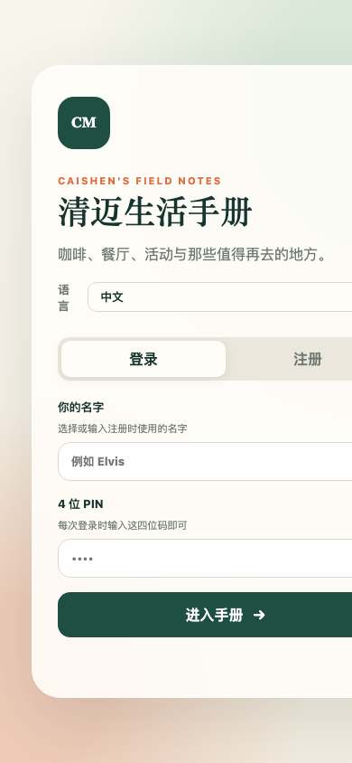

<div align="center">

# autoDownload

**Send a video link to any messenger — it downloads itself to your NAS / server**

[](https://www.python.org/)
[](https://github.com/yt-dlp/yt-dlp)
[](https://telegram.org/)
[](./LICENSE)

**Language / 语言 / 言語 / ภาษา:**
[简体中文](./README.md) · [English](./README.en.md) · [日本語](./README.ja.md) · [ไทย](./README.th.md)

</div>

---

## What problem does this solve? (Intent)

Every day we see YouTube, Bilibili, and news-site video links in Telegram / LINE / WeChat groups and want to keep them on a NAS or server for reference or offline viewing. The old workflow is:

- Copy the link → open a laptop → run yt-dlp → choose a folder → wait → rename and archive
- Re-sending the same link downloads it twice and fills the disk
- Failed downloads go unnoticed; next time you have to find the link again
- With multiple people, nobody knows "what is downloading right now / what failed"

**The intent of autoDownload**: turn "downloading" into **one message**. Paste a link in any messenger and the bot routes it to the right NAS folder, deduplicates it, shows live progress, records failures, and supports one-tap retry. Saving a video should feel as natural as chatting.

> This repository ships a **Telegram Bot** as the default implementation, but the download engine is fully decoupled from the messenger layer. Implement one `send(text, **kw)` callback and the same logic runs on LINE / WeChat / Discord / Slack / WeCom — any IM.

---

## Features

- 🎯 **Smart routing**: YouTube links → `language`; other links → `youturb`; prefix `指定` forces `youturb`; prefix `language` forces `language`
- 🚫 **Three-layer dedupe**: yt-dlp download archive + finished-file `[id]` check + concurrent inflight lock — duplicate links return "already exists, skipped" instantly
- 📊 **Live progress**: edits the same message every 2–3 seconds with a visual bar `████░░░░░░░░ 42.3%`, speed, and elapsed time; backs off automatically on Telegram 429
- 📥 **All downloads view**: lists every in-progress task (queued / downloading) and refreshes the same message every 3 seconds for up to ~6 minutes
- ❌ **Failure log + one-tap retry**: both metadata failures and download exceptions are persisted to JSON and survive restarts; `🔁 Retry all` re-runs each task and removes the ones that succeed
- 🔎 **Scan incomplete**: scans `*.part` / `*.ytdl` files, recovers the 11-character video ID from the filename, rebuilds the YouTube URL, and adds it to the retry list for resume
- 📝 **Subtitle 429 fallback**: when subtitles are rate-limited the download retries without subtitles and still completes (message appends "no subtitles")
- 🧩 **IM-agnostic**: the core `process_one(url, forced, send)` only needs a `send` callback, so any messenger can drive it
- 🔒 **Single-instance lock**: an fcntl lock prevents multiple processes from hitting `getUpdates` at once (409 Conflict / empty "downloading" list)
- 🗂 **Menu UX**: main / files / stats menus with both buttons and commands

---

## Architecture

```
┌──────────────┐    link message   ┌────────────────────┐
│  Any IM      │ ───────────────► │  IM adapter (send) │
│ TG/LINE/WeChat│                 │  (Telegram default)│
└──────────────┘                  └─────────┬──────────┘
                                           │
                                           ▼
                              ┌────────────────────────┐
                              │  process_one(url,..)   │
                              │  routing / dedupe /    │
                              │  progress              │
                              └─────────┬──────────────┘
                                        │
                    ┌───────────────────┼───────────────────┐
                    ▼                   ▼                   ▼
            ┌──────────────┐   ┌──────────────┐   ┌──────────────┐
            │  get_info    │   │ download_one │   │ active/failed│
            │  (yt-dlp)    │   │  (yt-dlp)    │   │  JSON store  │
            └──────┬───────┘   └──────┬───────┘   └──────────────┘
                   │                  │
                   ▼                  ▼
            ┌────────────────────────────────────┐
            │  NAS: /volume1/media/links/        │
            │   ├─ language/   (YouTube)         │
            │   └─ youturb/    (other links)     │
            └────────────────────────────────────┘
```

---

## Project layout

```
autoDownload/
├── bot.py                 # Main program (Telegram implementation + core engine)
├── verify_all.py          # 60-case end-to-end verification
├── install.sh             # Installer
├── restart.sh             # Safe restart (kills only the real python process)
├── yt-tg-bot.service      # systemd unit
├── .env.example           # Environment template
├── 部署文档.md            # Deployment & ops guide (Chinese)
├── assets/screenshots/    # Example screenshots
├── README.md              # 简体中文
├── README.en.md           # This file
├── README.ja.md           # 日本語
└── README.th.md           # ไทย
```

---

## Quick start (Telegram)

### 1. Prerequisites

- A Linux server / LXC container (this project runs on PVE LXC 104, Alpine 3.18)
- NAS mounted at `/mnt/nas-media` (NFS v4)
- Python 3.11+, yt-dlp, ffmpeg
- A Telegram bot token from @BotFather

### 2. Install

```bash
git clone https://github.com/zixiang2008/autoDownload.git
cd autoDownload
cp .env.example .env
# edit .env and set BOT_TOKEN etc.
pip install -r requirements.txt   # or use install.sh
./install.sh
```

### 3. Configure `.env`

```env
BOT_TOKEN=123456:ABC-your-token
DOWNLOAD_DIR=/mnt/nas-media/links/language
YOUTUBE_DIR=/mnt/nas-media/links/youturb
ADMIN_IDS=          # empty = everyone; or comma-separated Telegram user IDs
MAX_CONCURRENT=2
FAILED_STORE=/opt/yt-tg-bot/failed.json
LOCK_FILE=/run/yt-tg-bot.lock
```

### 4. Start

```bash
# OpenRC (Alpine)
rc-service yt-tg-bot start
# or systemd
systemctl start yt-tg-bot
```

### 5. Use it in Telegram

Send a video link to the bot. Multiple links and playlists are supported.

```
https://www.youtube.com/watch?v=xxxx
指定 https://www.youtube.com/watch?v=yyyy   # force youturb
language https://example.com/video.mp4       # force language
```

---

## Commands & menu

| Command | Purpose |
|---------|---------|
| `/start` | Main menu |
| `/status` `/stats` | Download statistics |
| `/files` | File list |
| `/downloading` | All downloads (live) |
| `/failed` | Failure list |
| `/retry` | Retry all failures |
| `/clearfailed` | Clear failure log |
| `/scan` | Scan incomplete downloads |
| `/sys` | System status |
| `/help` | Help |

Menu buttons: `📊 Stats` `📁 Files` `📥 Downloading` `❌ Failed` `⚙️ System` `📥 Usage` `❓ Help`

---

## Routing rules

| Input | Target directory |
|-------|------------------|
| YouTube link | `language` |
| Any other link (Bilibili / direct / news) | `youturb` |
| Prefix `指定` | force `youturb` |
| Prefix `language` / `语言` | force `language` |
| Prefix `youturb` / `youtube` / `yt` | force `youturb` |

---

## Connecting another IM (generic interface)

Core function signature:

```python
async def process_one(url: str, forced: Optional[str], send: Callable) -> bool
```

`send(text, **kw)` is an async callable that delivers a message to your IM. Implement it once:

```python
# LINE Messaging API
async def send(text, **kw):
    await line_bot_api.push_message(user_id, TextSendMessage(text=text))
    return None

# WeCom / Enterprise WeChat
async def send(text, **kw):
    await wecom.send_text(user_id, text)
    return None
```

Then call it from your message handler:

```python
urls = URL_RE.findall(text)
await asyncio.gather(*(process_one(u, forced, send) for u in urls), return_exceptions=True)
```

`active_text()` / `failed_text()` / `failed_kb()` are IM-agnostic and can be reused as-is.

---

## Example: the Chiang Mai Manual

A real-world use case: autoDownload batch-downloads Chiang Mai life, travel, and language-learning videos from YouTube to a NAS, forming the offline media library and content source for the **Chiang Mai Manual** PWA.

The Chiang Mai Manual is a private, community-maintained, mobile-first Chiang Mai life guide PWA (Node.js). It includes place search, category and distance filters, an interactive Thailand globe, Google Maps enrichment, and community submissions. Video material is downloaded and archived by this project, then consumed by the manual's Notion sync pipeline.

- Live demo: <https://cm.caishen.today> (login required)

### Screenshots

| Desktop | Mobile |
|--------|--------|
|  |  |

---

## Deployment notes (LXC / NAS)

- NAS exports `/volume1/media` → PVE fstab mounts `/mnt/nas-media` (nfs vers=4) → LXC mp0 binds the same path
- Service: OpenRC `yt-tg-bot` (Alpine) or systemd
- **Restart only with `restart.sh`** — never `pkill -f bot.py` (it kills the invoking shell too)
- Single-instance lock `/run/yt-tg-bot.lock` prevents multi-process 409 Conflict

See [部署文档.md](./部署文档.md) for full ops details (Chinese).

---

## Tests

```bash
# run inside the container (after deployment)
cd /opt/yt-tg-bot && python verify_all.py
# expected: TOTAL 60  PASS 60  FAIL 0  RESULT ALL_PASS
```

The harness calls `purge_test_artifacts()` at startup and asserts "no test artifacts" at the end (the directories already contain real videos, so it cannot assert "only one file remains").

---

## Known pitfalls

1. If `/mnt/nas-media` is not mounted, files land on the PVE local disk — verify with `mount -a`
2. OpenRC plus `/etc/local.d` double-start creates multiple instances → 409; local.d is disabled and the single-instance lock is the backstop
3. When yt-dlp hits the archive, `extract_info` returns `None`; handled as "skipped"
4. Never clean files with `*[ID]*` globs (brackets are character classes; this once deleted a real video)
5. Any external process must call `load_failed()` before writing `failed.json`, otherwise `save_failed()` overwrites the list with an empty one
6. The directories already hold many real videos, so tests must not assert "only one file left"

---

## License

MIT © 2026 zixiang2008
