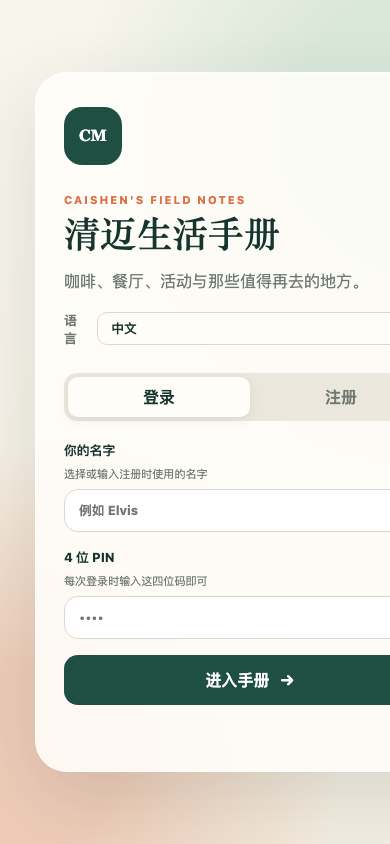

<div align="center">

# autoDownload

**動画リンクをメッセージアプリに送るだけで、NAS / サーバーへ自動ダウンロード**

[](https://www.python.org/)
[](https://github.com/yt-dlp/yt-dlp)
[](https://telegram.org/)
[](./LICENSE)

**言語 / Language / 语言 / ภาษา:**
[简体中文](./README.md) · [English](./README.en.md) · [日本語](./README.ja.md) · [ไทย](./README.th.md)

</div>

---

## このプロジェクトが解決する課題（意図）

Telegram / LINE / WeChat のグループで YouTube・Bilibili・ニュースサイトの動画リンクを見かけ、「NAS やサーバーに保存しておきたい」と思うことは日常的です。従来の流れはこうでした。

- リンクをコピー → PC を開く → yt-dlp を実行 → 保存先を選ぶ → 完了を待つ → 名前を整えて保管
- 同じリンクを再送すると二重ダウンロードになり、ディスクを圧迫する
- ダウンロード失敗に気づかず、次回またリンクを探すことになる
- 複数人で使うと「いま何をダウンロード中か / 何が失敗したか」が誰にも分からない

**autoDownload の意図**：ダウンロードを「メッセージを1通送るだけ」に変えること。どのメッセージアプリでもリンクを貼れば、ボットが適切な NAS フォルダへ振り分け、重複を排除し、進捗をリアルタイム表示し、失敗を記録してワンタップ再試行できます。動画の保存を、チャットと同じくらい自然に。

> 本リポジトリの既定実装は **Telegram Bot** ですが、ダウンロードエンジンはメッセージ層から完全に分離されています。`send(text, **kw)` コールバックを1つ実装すれば、同じロジックを LINE / WeChat / Discord / Slack / WeCom など任意の IM で動かせます。

---

## 機能

- 🎯 **スマート振り分け**：YouTube → `language`、その他 → `youturb`、先頭に `指定` で youturb 固定、`language` / `语言` で language 固定
- 🚫 **3層の重複排除**：yt-dlp のダウンロードアーカイブ + 完成ファイルの `[id]` 確認 + 同時実行 inflight ロック。重複リンクは即座に「既に存在、スキップ」
- 📊 **リアルタイム進捗**：2〜3 秒ごとに同じメッセージを編集し、バー `████░░░░░░░░ 42.3%`・速度・経過時間を表示。Telegram 429 では自動バックオフ
- 📥 **ダウンロード一覧（全件）**：進行中の全タスク（待機中 / ダウンロード中）を表示し、3 秒ごとに同じメッセージを最大約 6 分間更新
- ❌ **失敗ログ + ワンタップ再試行**：メタ情報取得失敗とダウンロード例外の両方を JSON に永続化し、再起動後も保持。`🔁 すべて再実行` で1件ずつ再試行し、成功したものは自動削除
- 🔎 **未完了のスキャン**：`*.part` / `*.ytdl` を走査し、ファイル名の 11 文字動画 ID から YouTube URL を復元して再試行リストに追加（レジューム対応）
- 📝 **字幕 429 フォールバック**：字幕がレート制限された場合は字幕なしで再試行し、動画自体は完了（メッセージに「字幕なし」を追記）
- 🧩 **IM 非依存**：コアの `process_one(url, forced, send)` は `send` コールバックだけに依存
- 🔒 **単一インスタンスロック**：fcntl ロックで複数プロセスの同時 `getUpdates`（409 Conflict / 一覧が空）を防止
- 🗂 **メニュー UI**：メイン / ファイル / 統計メニュー、ボタンとコマンドの両対応

---

## アーキテクチャ

```
┌──────────────┐   リンクメッセージ  ┌────────────────────┐
│  任意の IM    │ ───────────────► │  IM アダプタ(send) │
│ TG/LINE/WeChat│                 │  (Telegram 既定)   │
└──────────────┘                  └─────────┬──────────┘
                                           │
                                           ▼
                              ┌────────────────────────┐
                              │  process_one(url,..)   │
                              │  振り分け / 重複排除 / │
                              │  進捗                  │
                              └─────────┬──────────────┘
                                        │
                    ┌───────────────────┼───────────────────┐
                    ▼                   ▼                   ▼
            ┌──────────────┐   ┌──────────────┐   ┌──────────────┐
            │  get_info    │   │ download_one │   │ active/failed│
            │  (yt-dlp)    │   │  (yt-dlp)    │   │  JSON store  │
            └──────┬───────┘   └──────┬───────┘   └──────────────┘
                   │                  │
                   ▼                  ▼
            ┌────────────────────────────────────┐
            │  NAS: /volume1/media/links/        │
            │   ├─ language/   (YouTube)          │
            │   └─ youturb/    (その他リンク)     │
            └────────────────────────────────────┘
```

---

## ディレクトリ構成

```
autoDownload/
├── bot.py                 # メインプログラム（Telegram 実装 + コアエンジン）
├── verify_all.py          # 60 項目の E2E 検証スクリプト
├── install.sh             # インストーラ
├── restart.sh             # 安全な再起動（本物の python プロセスのみ停止）
├── yt-tg-bot.service      # systemd ユニット
├── .env.example           # 環境変数テンプレート
├── 部署文档.md            # デプロイ・運用ドキュメント（中国語）
├── assets/screenshots/    # サンプルスクリーンショット
├── README.md              # 简体中文
├── README.en.md           # English
├── README.ja.md           # 本ファイル
└── README.th.md           # ไทย
```

---

## クイックスタート（Telegram）

### 1. 前提

- Linux サーバー / LXC コンテナ（本プロジェクトは PVE LXC 104、Alpine 3.18 で稼働）
- NAS を `/mnt/nas-media` にマウント（NFS v4）
- Python 3.11+、yt-dlp、ffmpeg
- @BotFather で取得した Telegram Bot トークン

### 2. インストール

```bash
git clone https://github.com/zixiang2008/autoDownload.git
cd autoDownload
cp .env.example .env
# .env を編集して BOT_TOKEN などを設定
pip install -r requirements.txt   # または install.sh
./install.sh
```

### 3. `.env` の設定

```env
BOT_TOKEN=123456:ABC-your-token
DOWNLOAD_DIR=/mnt/nas-media/links/language
YOUTUBE_DIR=/mnt/nas-media/links/youturb
ADMIN_IDS=          # 空 = 全員可、または Telegram ユーザー ID をカンマ区切り
MAX_CONCURRENT=2
FAILED_STORE=/opt/yt-tg-bot/failed.json
LOCK_FILE=/run/yt-tg-bot.lock
```

### 4. 起動

```bash
# OpenRC (Alpine)
rc-service yt-tg-bot start
# または systemd
systemctl start yt-tg-bot
```

### 5. Telegram での使い方

ボットに動画リンクを送るだけ。複数リンクやプレイリストにも対応。

```
https://www.youtube.com/watch?v=xxxx
指定 https://www.youtube.com/watch?v=yyyy   # youturb 固定
language https://example.com/video.mp4       # language 固定
```

---

## コマンドとメニュー

| コマンド | 説明 |
|----------|------|
| `/start` | メインメニュー |
| `/status` `/stats` | ダウンロード統計 |
| `/files` | ファイル一覧 |
| `/downloading` | ダウンロード中（全件・リアルタイム） |
| `/failed` | 失敗一覧 |
| `/retry` | 失敗をすべて再試行 |
| `/clearfailed` | 失敗記録を消去 |
| `/scan` | 未完了ダウンロードをスキャン |
| `/sys` | システム状態 |
| `/help` | ヘルプ |

メニューボタン：`📊 統計` `📁 ファイル` `📥 ダウンロード中` `❌ 失敗` `⚙️ システム` `📥 使い方` `❓ ヘルプ`

---

## 振り分けルール

| 入力 | 保存先 |
|------|--------|
| YouTube リンク | `language` |
| その他のリンク（Bilibili / 直リンク / ニュース） | `youturb` |
| 先頭に `指定` | `youturb` 固定 |
| 先頭に `language` / `语言` | `language` 固定 |
| 先頭に `youturb` / `youtube` / `yt` | `youturb` 固定 |

---

## 他の IM への接続（汎用インターフェース）

コア関数のシグネチャ：

```python
async def process_one(url: str, forced: Optional[str], send: Callable) -> bool
```

`send(text, **kw)` は IM にメッセージを届ける非同期呼び出し可能オブジェクトです。1つ実装するだけ：

```python
# LINE Messaging API
async def send(text, **kw):
    await line_bot_api.push_message(user_id, TextSendMessage(text=text))
    return None

# WeCom（企業微信）
async def send(text, **kw):
    await wecom.send_text(user_id, text)
    return None
```

メッセージハンドラから呼び出します：

```python
urls = URL_RE.findall(text)
await asyncio.gather(*(process_one(u, forced, send) for u in urls), return_exceptions=True)
```

`active_text()` / `failed_text()` / `failed_kb()` は IM 非依存でそのまま再利用できます。

---

## 実例：チェンマイ生活マニュアル

実際のユースケース：autoDownload がチェンマイの生活・旅行・語学学習動画を YouTube から NAS へ一括ダウンロードし、**チェンマイ生活マニュアル** PWA のオフライン素材ライブラリ兼コンテンツソースになります。

チェンマイ生活マニュアルは、非公開・コミュニティ運営・モバイルファーストのチェンマイ生活ガイド PWA（Node.js）です。場所検索、カテゴリ／距離フィルター、タイの地球儀ビュー、Google Maps 情報補完、コミュニティ投稿などを備えます。動画素材は本プロジェクトでダウンロード・アーカイブされ、マニュアルの Notion 同期パイプラインで利用されます。

- ライブデモ：<https://cm.caishen.today>（ログインが必要）

### スクリーンショット

| デスクトップ | モバイル |
|--------------|----------|
|  |  |

---

## デプロイの要点（LXC / NAS）

- NAS が `/volume1/media` をエクスポート → PVE fstab が `/mnt/nas-media` にマウント（nfs vers=4）→ LXC mp0 が同一パスをバインド
- サービス：OpenRC `yt-tg-bot`（Alpine）または systemd
- **再起動は `restart.sh` のみ**。`pkill -f bot.py` は禁止（実行中のシェルも巻き込む）
- 単一インスタンスロック `/run/yt-tg-bot.lock` で複数プロセスの 409 Conflict を防止

詳細は [部署文档.md](./部署文档.md)（中国語）を参照。

---

## テスト

```bash
# コンテナ内で実行（デプロイ後）
cd /opt/yt-tg-bot && python verify_all.py
# 期待値：TOTAL 60  PASS 60  FAIL 0  RESULT ALL_PASS
```

検証スクリプトは起動時に `purge_test_artifacts()` で過去の残留物を消し、最後に「テスト生成物が無いこと」を検証します（ディレクトリには実動画が多数あるため「1ファイルだけ」とは検証できません）。

---

## 既知の落とし穴

1. `/mnt/nas-media` が未マウントだと PVE ローカルディスクに保存される — `mount -a` で確認
2. OpenRC と `/etc/local.d` の二重起動で複数インスタンス → 409。local.d は無効化し、単一インスタンスロックで担保
3. yt-dlp がアーカイブにヒットすると `extract_info` が `None` を返す — 「スキップ」として処理済み
4. `*[ID]*` グロブでファイル削除しない（角括弧は文字クラス。過去に実動画を誤削除）
5. 外部プロセスが `failed.json` を書く前に必ず `load_failed()` を呼ぶ。さもないと `save_failed()` が空リストで上書きする
6. ディレクトリには実動画が多いため、テストで「残り1ファイル」と断言してはいけない

---

## ライセンス

MIT © 2026 zixiang2008
