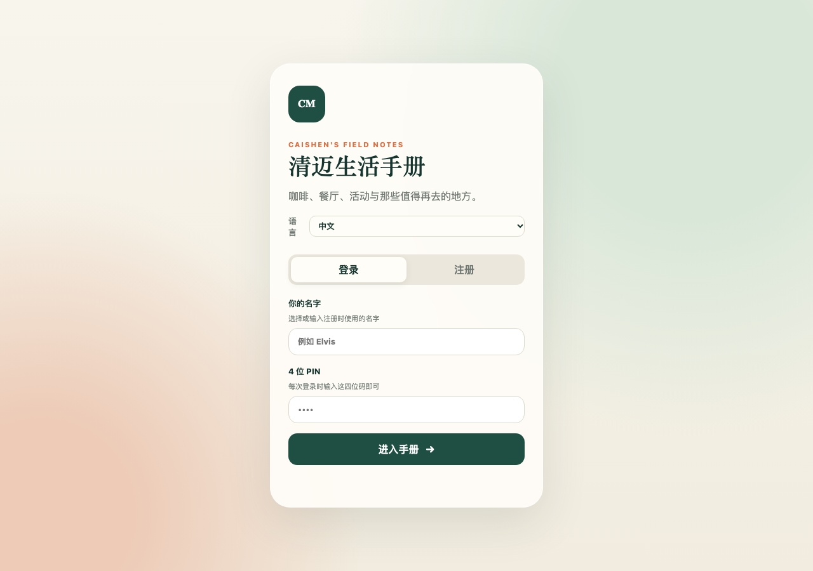
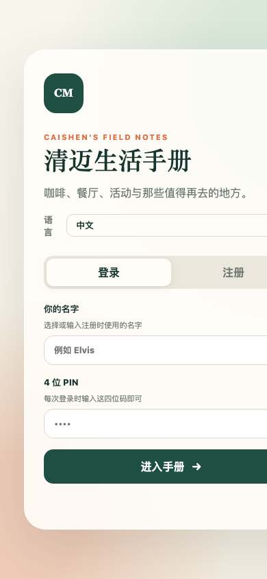

<div align="center">

# autoDownload

**把视频链接发给即时通讯工具，自动下载到 NAS / 服务器指定目录**

[](https://www.python.org/)
[](https://github.com/yt-dlp/yt-dlp)
[](https://telegram.org/)
[](./LICENSE)

**语言 / Language / 言語 / ภาษา:**
[简体中文](./README.md) · [English](./README.en.md) · [日本語](./README.ja.md) · [ไทย](./README.th.md)

</div>

---

## 这个项目解决什么问题（意图）

日常里我们经常在 Telegram / LINE / 微信 群里看到 YouTube、B 站、新闻站点的视频链接，想保存到 NAS / 服务器做素材或离线观看。传统做法是：

- 手动复制链接 → 打开电脑 → 跑 yt-dlp → 选目录 → 等下载 → 命名归档
- 重复发同一链接会重复下载，占满磁盘
- 下载失败了不知道，下次又得重新找链接
- 多人协作时没人知道"正在下载什么 / 哪些失败了"

**autoDownload 的意图**：把"下载"这件事变成**发一条消息**——在任何即时通讯工具里粘贴链接，机器人自动按规则路由到正确的 NAS 目录、去重、显示实时进度、记录失败并支持一键重试。让"保存视频"和"聊天"一样自然。

> 本仓库以 **Telegram Bot** 为默认实现，但核心下载引擎与 IM 适配层完全解耦：你只需要实现一个 `send(text, **kw)` 回调，就可以把同一套逻辑挂到 LINE / 微信 / Discord / Slack / 企业微信 等任何 IM 上。

---

## 功能特性

- 🎯 **智能路由**：YouTube 链接 → `language` 目录；其它链接 → `youturb` 目录；消息前加 `指定` 强制 youturb；加 `language`/`语言` 强制 language
- 🚫 **三层去重**：yt-dlp 下载档案 + 成品文件 `[id]` 检查 + 并发 inflight 锁，重复链接秒回"已存在，跳过"
- 📊 **实时进度**：下载中每 2~3 秒编辑同一条消息，带可视化进度条 `████░░░░░░░░ 42.3%`、速度、已用时；Telegram 429 时自动退避
- 📥 **正在下载列表（全量）**：列出所有进行中任务（排队中 / 下载中），后台每 3 秒自动刷新，最长约 6 分钟
- ❌ **失败任务记录 + 一键重试**：获取信息失败 / 下载异常两类失败持久化到 JSON，重启不丢；`🔁 全部重新执行` 逐条重跑，成功的自动移除
- 🔎 **扫描未完成**：扫目录里的 `*.part` / `*.ytdl`，用文件名中的 11 位视频 ID 还原成 YouTube 链接并加入失败列表续传
- 📝 **字幕 429 降级**：字幕被限流时自动降级为"无字幕"重试，视频仍可完成（提示追加"（无字幕）"）
- 🧩 **IM 解耦**：核心 `process_one(url, forced, send)` 只依赖一个 `send` 回调，可适配任何 IM
- 🔒 **单实例锁**：fcntl 锁防止多进程同时 getUpdates 造成 409 Conflict / "正在下载列表为空"
- 🗂 **菜单交互**：主菜单 / 文件菜单 / 统计菜单，按钮与命令双入口

---

## 架构

```
┌──────────────┐      链接消息      ┌────────────────────┐
│  任何 IM     │ ───────────────► │  IM 适配层 (send)  │
│ TG/LINE/微信 │                  │  (Telegram 默认)   │
└──────────────┘                  └─────────┬──────────┘
                                           │
                                           ▼
                              ┌────────────────────────┐
                              │  process_one(url,..)   │
                              │  路由 / 去重 / 进度   │
                              └─────────┬──────────────┘
                                        │
                    ┌───────────────────┼───────────────────┐
                    ▼                   ▼                   ▼
            ┌──────────────┐   ┌──────────────┐   ┌──────────────┐
            │  get_info    │   │ download_one │   │ active/failed│
            │  (yt-dlp)    │   │  (yt-dlp)    │   │  JSON store  │
            └──────┬───────┘   └──────┬───────┘   └──────────────┘
                   │                  │
                   ▼                  ▼
            ┌────────────────────────────────────┐
            │  NAS: /volume1/media/links/        │
            │   ├─ language/   (YouTube)         │
            │   └─ youturb/    (其它链接)        │
            └────────────────────────────────────┘
```

---

## 目录结构

```
autoDownload/
├── bot.py                 # 主程序（Telegram 实现 + 核心引擎）
├── verify_all.py          # 60 项端到端验证脚本
├── install.sh             # 安装脚本
├── restart.sh             # 安全重启脚本（仅杀真正的 python 进程）
├── yt-tg-bot.service      # systemd 服务文件
├── .env.example           # 环境变量模板
├── 部署文档.md            # 部署与运维文档
├── assets/screenshots/    # 示例截图
├── README.md              # 本文件（中文）
├── README.en.md           # English
├── README.ja.md           # 日本語
└── README.th.md           # ไทย
```

---

## 快速开始（Telegram）

### 1. 准备环境

- 一台 Linux 服务器 / LXC 容器（本项目运行在 PVE LXC 104，Alpine 3.18）
- NAS 挂载到 `/mnt/nas-media`（NFS v4）
- Python 3.11+、yt-dlp、ffmpeg
- Telegram Bot Token（从 @BotFather 获取）

### 2. 安装

```bash
git clone https://github.com/zixiang2008/autoDownload.git
cd autoDownload
cp .env.example .env
# 编辑 .env 填入 BOT_TOKEN 等
pip install -r requirements.txt   # 或按 install.sh
./install.sh
```

### 3. 配置 `.env`

```env
BOT_TOKEN=123456:ABC-your-token
DOWNLOAD_DIR=/mnt/nas-media/links/language
YOUTUBE_DIR=/mnt/nas-media/links/youturb
ADMIN_IDS=          # 留空 = 所有人可用；填 Telegram user id 限制
MAX_CONCURRENT=2
FAILED_STORE=/opt/yt-tg-bot/failed.json
LOCK_FILE=/run/yt-tg-bot.lock
```

### 4. 启动

```bash
# OpenRC (Alpine)
rc-service yt-tg-bot start
# 或 systemd
systemctl start yt-tg-bot
```

### 5. 在 Telegram 中使用

直接把视频链接发给 Bot 即可。支持多链接、播放列表。

```
https://www.youtube.com/watch?v=xxxx
指定 https://www.youtube.com/watch?v=yyyy   # 强制存 youturb
language https://example.com/video.mp4       # 强制存 language
```

---

## 命令与菜单

| 命令 | 说明 |
|------|------|
| `/start` | 主菜单 |
| `/status` `/stats` | 已下载统计 |
| `/files` | 文件列表 |
| `/downloading` | 正在下载（全量 + 实时） |
| `/failed` | 失败任务列表 |
| `/retry` | 重试全部失败 |
| `/clearfailed` | 清空失败记录 |
| `/scan` | 扫描未完成下载 |
| `/sys` | 系统状态 |
| `/help` | 帮助 |

菜单按钮：`📊 统计信息` `📁 文件管理` `📥 正在下载` `❌ 失败任务` `⚙️ 系统状态` `📥 使用说明` `❓ 帮助`

---

## 路由规则

| 输入 | 目标目录 |
|------|----------|
| YouTube 链接 | `language` |
| 其它链接（B 站 / 直链 / 新闻站） | `youturb` |
| 前缀 `指定` | 强制 `youturb` |
| 前缀 `language` / `语言` | 强制 `language` |
| 前缀 `youturb` / `youtube` / `yt` | 强制 `youturb` |

---

## 适配其它 IM（通用接口）

核心下载函数签名：

```python
async def process_one(url: str, forced: Optional[str], send: Callable) -> bool
```

`send(text, **kw)` 是一个异步可调用对象，负责把消息发到 IM。你只需要为你的 IM 实现 `send`：

```python
# LINE Messaging API 示例
async def send(text, **kw):
    await line_bot_api.push_message(user_id, TextSendMessage(text=text))
    return None

# 企业微信 示例
async def send(text, **kw):
    await wecom.send_text(user_id, text)
    return None
```

然后在消息处理器里调用：

```python
urls = URL_RE.findall(text)
await asyncio.gather(*(process_one(u, forced, send) for u in urls), return_exceptions=True)
```

`active_text()` / `failed_text()` / `failed_kb()` 等文案函数与 IM 无关，可直接复用。

---

## 示例：《清迈生活手册》

autoDownload 的一个实际应用场景：把 YouTube 上的清迈生活、旅行、语言学习视频批量下载到 NAS，作为《清迈生活手册》PWA 的离线素材库与内容来源。

《清迈生活手册》是一个私有、社区维护、移动优先的清迈生活指南 PWA（Next.js/Node.js），包含地点搜索、分类与距离筛选、泰国地球仪视图、Google Maps 信息补全、社区投稿等功能。视频素材通过本项目自动下载并归档，再由手册的 Notion 同步流程消费。

- 在线演示：<https://cm.caishen.today>（需账号登录）

### 截图

| 桌面端 | 移动端 |
|--------|--------|
|  |  |

---

## 部署要点（LXC / NAS）

- NAS 导出 `/volume1/media` → PVE fstab 挂 `/mnt/nas-media` (nfs vers=4) → LXC mp0 绑定同路径
- 服务：OpenRC `yt-tg-bot`（Alpine）或 systemd
- **重启只用 `restart.sh`**，禁止 `pkill -f bot.py`（会误杀执行命令的 shell）
- 单实例锁 `/run/yt-tg-bot.lock` 防止多进程 409 Conflict

详细运维见 [部署文档.md](./部署文档.md)。

---

## 测试

```bash
# 在容器内运行（需先部署）
cd /opt/yt-tg-bot && python verify_all.py
# 预期：TOTAL 60  PASS 60  FAIL 0  RESULT ALL_PASS
```

验证脚本会在启动时 `purge_test_artifacts()` 清理历次残留，结尾断言"不含测试产物"（目录里已有真实视频，不能断言"只剩一个文件"）。

---

## 已知坑

1. `/mnt/nas-media` 未挂载时文件会落 PVE 本地盘，需 `mount -a` 复核
2. OpenRC 与 `/etc/local.d` 双启动会造成多实例 → 409；已禁用 local.d + 单实例锁兜底
3. yt-dlp 命中 archive 时 `extract_info` 返 `None`，已处理为"跳过"
4. 清理文件禁用 `*[ID]*` glob（方括号是字符类，曾误删真实视频）
5. 外部进程写 `failed.json` 前必须先 `load_failed()`，否则 `save_failed()` 用空列表覆盖
6. 目录里已有大量真实视频，测试不能断言"目录只剩一个文件"

---

## License

MIT © 2026 zixiang2008
