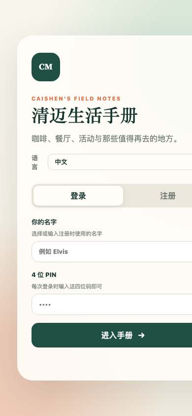

<div align="center">

# autoDownload

**ส่งลิงก์วิดีโอเข้าแอปแชท แล้วดาวน์โหลดลง NAS / เซิร์ฟเวอร์โดยอัตโนมัติ**

[](https://www.python.org/)
[](https://github.com/yt-dlp/yt-dlp)
[](https://telegram.org/)
[](./LICENSE)

**ภาษา / Language / 语言 / 言語:**
[简体中文](./README.md) · [English](./README.en.md) · [日本語](./README.ja.md) · [ไทย](./README.th.md)

</div>

---

## โครงการนี้แก้ปัญหาอะไร (เจตนารมณ์)

ในชีวิตประจำวัน เรามักเห็นลิงก์วิดีโอ YouTube, Bilibili หรือเว็บข่าวในกลุ่ม Telegram / LINE / WeChat และต้องการเก็บไว้บน NAS หรือเซิร์ฟเวอร์เพื่อใช้เป็นสื่อหรือดูแบบออฟไลน์ วิธีเดิมคือ:

- คัดลอกลิงก์ → เปิดคอมพิวเตอร์ → รัน yt-dlp → เลือกโฟลเดอร์ → รอ → ตั้งชื่อและเก็บเข้าคลัง
- ส่งลิงก์เดิมซ้ำจะดาวน์โหลดซ้ำและกินพื้นที่ดิสก์
- ดาวน์โหลดล้มเหลวโดยไม่รู้ตัว ครั้งหน้าต้องหาลิงก์ใหม่
- เมื่อมีหลายคน ไม่มีใครรู้ว่า "กำลังดาวน์โหลดอะไร / อะไรล้มเหลว"

**เจตนารมณ์ของ autoDownload**: เปลี่ยน "การดาวน์โหลด" ให้เป็น **การส่งข้อความหนึ่งครั้ง** — วางลิงก์ในแอปแชทใดก็ได้ บอทจะจัดเส้นทางไปยังโฟลเดอร์ NAS ที่ถูกต้อง ตัดไฟล์ซ้ำ แสดงความคืบหน้าแบบเรียลไทม์ บันทึกความล้มเหลว และรองรับการลองใหม่ในคลิกเดียว การบันทึกวิดีโอควรเป็นธรรมชาติเหมือนการแชท

> รีโปนี้ใช้ **Telegram Bot** เป็นค่าตั้งต้น แต่แกนดาวน์โหลดแยกจากชั้น IM อย่างสมบูรณ์ เพียงเขียน callback `send(text, **kw)` หนึ่งตัว ก็ใช้ตรรกะเดียวกันกับ LINE / WeChat / Discord / Slack / WeCom หรือ IM ใดก็ได้

---

## คุณสมบัติ

- 🎯 **จัดเส้นทางอัจฉริยะ**: ลิงก์ YouTube → `language`; ลิงก์อื่น → `youturb`; นำหน้าด้วย `指定` บังคับ `youturb`; นำหน้าด้วย `language` / `语言` บังคับ `language`
- 🚫 **ตัดซ้ำสามชั้น**: download archive ของ yt-dlp + ตรวจไฟล์ที่เสร็จแล้วด้วย `[id]` + inflight lock สำหรับงานพร้อมกัน ลิงก์ซ้ำจะตอบ "มีอยู่แล้ว ข้าม" ทันที
- 📊 **ความคืบหน้าเรียลไทม์**: แก้ไขข้อความเดิมทุก 2–3 วินาที พร้อมแถบ `████░░░░░░░░ 42.3%` ความเร็ว และเวลาที่ใช้; ถ้าเจอ Telegram 429 จะหน่วงอัตโนมัติ
- 📥 **รายการกำลังดาวน์โหลด (ทั้งหมด)**: แสดงงานที่กำลังทำทั้งหมด (รอคิว / กำลังดาวน์โหลด) และรีเฟรชข้อความเดิมทุก 3 วินาที นานสูงสุดประมาณ 6 นาที
- ❌ **บันทึกงานล้มเหลว + ลองใหม่ทั้งหมด**: ทั้งการดึงข้อมูลล้มเหลวและข้อยกเว้นตอนดาวน์โหลดถูกบันทึกเป็น JSON คงอยู่หลังรีสตาร์ท; `🔁 ลองใหม่ทั้งหมด` จะรันซ้ำทีละรายการและลบรายการที่สำเร็จออก
- 🔎 **สแกนงานที่ยังไม่เสร็จ**: สแกนไฟล์ `*.part` / `*.ytdl` ดึงรหัสวิดีโอ 11 ตัวอักษรจากชื่อไฟล์ สร้าง URL YouTube ใหม่ แล้วเพิ่มเข้าリストลองใหม่เพื่อดาวน์โหลดต่อ
- 📝 **สำรองเมื่อซับไตเติล 429**: เมื่อซับไตเติลถูกจำกัดอัตรา จะลองใหม่โดยไม่มีซับไตเติลและวิดีโอยังดาวน์โหลดสำเร็จ (ข้อความต่อท้าย "ไม่มีซับไตเติล")
- 🧩 **ไม่ผูกกับ IM**: แกน `process_one(url, forced, send)` ต้องการเพียง callback `send`
- 🔒 **ล็อกอินสแตนซ์เดียว**: fcntl lock ป้องกันหลายโปรเซสเรียก `getUpdates` พร้อมกัน (409 Conflict / รายการว่าง)
- 🗂 **เมนู**: เมนูหลัก / ไฟล์ / สถิติ ใช้ได้ทั้งปุ่มและคำสั่ง

---

## สถาปัตยกรรม

```
┌──────────────┐   ข้อความลิงก์   ┌────────────────────┐
│  IM ใดก็ได้  │ ───────────────► │  IM adapter (send) │
│ TG/LINE/WeChat│                 │  (Telegram ค่าเริ่มต้น)│
└──────────────┘                  └─────────┬──────────┘
                                           │
                                           ▼
                              ┌────────────────────────┐
                              │  process_one(url,..)   │
                              │  จัดเส้นทาง / ตัดซ้ำ / │
                              │  ความคืบหน้า           │
                              └─────────┬──────────────┘
                                        │
                    ┌───────────────────┼───────────────────┐
                    ▼                   ▼                   ▼
            ┌──────────────┐   ┌──────────────┐   ┌──────────────┐
            │  get_info    │   │ download_one │   │ active/failed│
            │  (yt-dlp)    │   │  (yt-dlp)    │   │  JSON store  │
            └──────┬───────┘   └──────┬───────┘   └──────────────┘
                   │                  │
                   ▼                  ▼
            ┌────────────────────────────────────┐
            │  NAS: /volume1/media/links/        │
            │   ├─ language/   (YouTube)          │
            │   └─ youturb/    (ลิงก์อื่น)         │
            └────────────────────────────────────┘
```

---

## โครงสร้างโปรเจกต์

```
autoDownload/
├── bot.py                 # โปรแกรมหลัก (Telegram + แกนดาวน์โหลด)
├── verify_all.py          # สคริปต์ตรวจสอบ E2E 60 กรณี
├── install.sh             # สคริปต์ติดตั้ง
├── restart.sh             # รีสตาร์ทอย่างปลอดภัย (ฆ่าเฉพาะโปรเซส python จริง)
├── yt-tg-bot.service      # ไฟล์ systemd
├── .env.example           # เทมเพลตตัวแปรสภาพแวดล้อม
├── 部署文档.md            # เอกสารติดตั้งและปฏิบัติการ (จีน)
├── assets/screenshots/    # ภาพหน้าจอตัวอย่าง
├── README.md              # 简体中文
├── README.en.md           # English
├── README.ja.md           # 日本語
└── README.th.md           # ไฟล์นี้
```

---

## เริ่มต้นอย่างรวดเร็ว (Telegram)

### 1. สิ่งที่ต้องมี

- เซิร์ฟเวอร์ Linux / คอนเทนเนอร์ LXC (โปรเจกต์นี้รันบน PVE LXC 104, Alpine 3.18)
- NAS เมานต์ที่ `/mnt/nas-media` (NFS v4)
- Python 3.11+, yt-dlp, ffmpeg
- Telegram Bot Token จาก @BotFather

### 2. ติดตั้ง

```bash
git clone https://github.com/zixiang2008/autoDownload.git
cd autoDownload
cp .env.example .env
# แก้ .env ใส่ BOT_TOKEN ฯลฯ
pip install -r requirements.txt   # หรือใช้ install.sh
./install.sh
```

### 3. ตั้งค่า `.env`

```env
BOT_TOKEN=123456:ABC-your-token
DOWNLOAD_DIR=/mnt/nas-media/links/language
YOUTUBE_DIR=/mnt/nas-media/links/youturb
ADMIN_IDS=          # ว่าง = ทุกคน, หรือใส่ Telegram user id คั่นด้วยจุลภาค
MAX_CONCURRENT=2
FAILED_STORE=/opt/yt-tg-bot/failed.json
LOCK_FILE=/run/yt-tg-bot.lock
```

### 4. เริ่มทำงาน

```bash
# OpenRC (Alpine)
rc-service yt-tg-bot start
# หรือ systemd
systemctl start yt-tg-bot
```

### 5. ใช้งานใน Telegram

ส่งลิงก์วิดีโอให้บอทได้เลย รองรับหลายลิงก์และเพลย์ลิสต์

```
https://www.youtube.com/watch?v=xxxx
指定 https://www.youtube.com/watch?v=yyyy   # บังคับ youturb
language https://example.com/video.mp4       # บังคับ language
```

---

## คำสั่งและเมนู

| คำสั่ง | คำอธิบาย |
|--------|----------|
| `/start` | เมนูหลัก |
| `/status` `/stats` | สถิติการดาวน์โหลด |
| `/files` | รายการไฟล์ |
| `/downloading` | กำลังดาวน์โหลด (ทั้งหมด + เรียลไทม์) |
| `/failed` | รายการที่ล้มเหลว |
| `/retry` | ลองใหม่ทั้งหมด |
| `/clearfailed` | ล้างบันทึกที่ล้มเหลว |
| `/scan` | สแกนงานที่ยังไม่เสร็จ |
| `/sys` | สถานะระบบ |
| `/help` | ช่วยเหลือ |

ปุ่มเมนู: `📊 สถิติ` `📁 ไฟล์` `📥 กำลังดาวน์โหลด` `❌ ล้มเหลว` `⚙️ ระบบ` `📥 วิธีใช้` `❓ ช่วยเหลือ`

---

## กฎการจัดเส้นทาง

| อินพุต | โฟลเดอร์ปลายทาง |
|--------|------------------|
| ลิงก์ YouTube | `language` |
| ลิงก์อื่น (Bilibili / ลิงก์ตรง / เว็บข่าว) | `youturb` |
| นำหน้า `指定` | บังคับ `youturb` |
| นำหน้า `language` / `语言` | บังคับ `language` |
| นำหน้า `youturb` / `youtube` / `yt` | บังคับ `youturb` |

---

## เชื่อมต่อ IM อื่น (อินเทอร์เฟซทั่วไป)

ลายเซ็นฟังก์ชันแกน:

```python
async def process_one(url: str, forced: Optional[str], send: Callable) -> bool
```

`send(text, **kw)` คือ async callable ที่ส่งข้อความไปยัง IM ของคุณ เขียนเพียงครั้งเดียว:

```python
# LINE Messaging API
async def send(text, **kw):
    await line_bot_api.push_message(user_id, TextSendMessage(text=text))
    return None

# WeCom / Enterprise WeChat
async def send(text, **kw):
    await wecom.send_text(user_id, text)
    return None
```

แล้วเรียกจาก message handler:

```python
urls = URL_RE.findall(text)
await asyncio.gather(*(process_one(u, forced, send) for u in urls), return_exceptions=True)
```

`active_text()` / `failed_text()` / `failed_kb()` ไม่ผูกกับ IM และนำกลับมาใช้ได้ทันที

---

## ตัวอย่าง: คู่มือชีวิตเชียงใหม่

กรณีใช้งานจริง: autoDownload ดาวน์โหลดวิดีโอเกี่ยวกับชีวิตเชียงใหม่ การท่องเที่ยว และการเรียนรู้ภาษาจาก YouTube ลง NAS เป็นคลังสื่อออฟไลน์และแหล่งเนื้อหาของ PWA **คู่มือชีวิตเชียงใหม่**

คู่มือชีวิตเชียงใหม่เป็น PWA คู่มือการใช้ชีวิตในเชียงใหม่แบบส่วนตัว ดูแลโดยชุมชน และออกแบบสำหรับมือถือเป็นหลัก (Node.js) ประกอบด้วยการค้นหาสถานที่ ตัวกรองหมวดหมู่และระยะทาง ลูกโลกประเทศไทยแบบอินเทอร์แอกทีฟ การเติมข้อมูลจาก Google Maps และการส่งข้อมูลโดยชุมชน วิดีโอจะถูกดาวน์โหลดและเก็บถาวรโดยโปรเจกต์นี้ แล้วนำไปใช้ในไปป์ไลน์ซิงก์ Notion ของคู่มือ

- เดโมออนไลน์: <https://cm.caishen.today> (ต้องเข้าสู่ระบบ)

### ภาพหน้าจอ

| เดสก์ท็อป | มือถือ |
|-----------|--------|
|  |  |

---

## หมายเหตุการติดตั้ง (LXC / NAS)

- NAS export `/volume1/media` → PVE fstab เมานต์ `/mnt/nas-media` (nfs vers=4) → LXC mp0 bind พาธเดียวกัน
- บริการ: OpenRC `yt-tg-bot` (Alpine) หรือ systemd
- **รีสตาร์ทด้วย `restart.sh` เท่านั้น** ห้ามใช้ `pkill -f bot.py` (จะฆ่าเชลล์ที่รันคำสั่งด้วย)
- ล็อกอินสแตนซ์เดียว `/run/yt-tg-bot.lock` ป้องกัน 409 Conflict จากหลายโปรเซส

ดูรายละเอียดที่ [部署文档.md](./部署文档.md) (ภาษาจีน)

---

## การทดสอบ

```bash
# รันในคอนเทนเนอร์ (หลังติดตั้ง)
cd /opt/yt-tg-bot && python verify_all.py
# ผลที่คาด: TOTAL 60  PASS 60  FAIL 0  RESULT ALL_PASS
```

สคริปต์จะเรียก `purge_test_artifacts()` ตอนเริ่มเพื่อล้างของเหลือจากการทดสอบครั้งก่อน และตรวจสอบตอนท้ายว่า "ไม่มีไฟล์ทดสอบ" (โฟลเดอร์มีวิดีโอจริงอยู่มาก จึงยืนยันว่า "เหลือไฟล์เดียว" ไม่ได้)

---

## ข้อควรระวังที่รู้แล้ว

1. ถ้า `/mnt/nas-media` ไม่ได้เมานต์ ไฟล์จะไปลงดิสก์ท้องถิ่นของ PVE — ตรวจด้วย `mount -a`
2. OpenRC กับ `/etc/local.d` เปิดพร้อมกันทำให้มีหลายอินสแตนซ์ → 409; ปิด local.d แล้วและใช้ล็อกอินสแตนซ์เดียวเป็นตัวสำรอง
3. เมื่อ yt-dlp ตรงกับ archive `extract_info` จะคืน `None` — จัดการเป็น "ข้าม" แล้ว
4. ห้ามลบไฟล์ด้วย glob `*[ID]*` (วงเล็บเหลี่ยมเป็น character class เคยลบวิดีโอจริงไปแล้ว)
5. โปรเซสภายนอกต้องเรียก `load_failed()` ก่อนเขียน `failed.json` ไม่อย่างนั้น `save_failed()` จะเขียนทับด้วยรายการว่าง
6. โฟลเดอร์มีวิดีโอจริงจำนวนมาก การทดสอบต้องไม่ยืนยันว่า "เหลือไฟล์เดียว"

---

## สัญญาอนุญาต

MIT © 2026 zixiang2008
